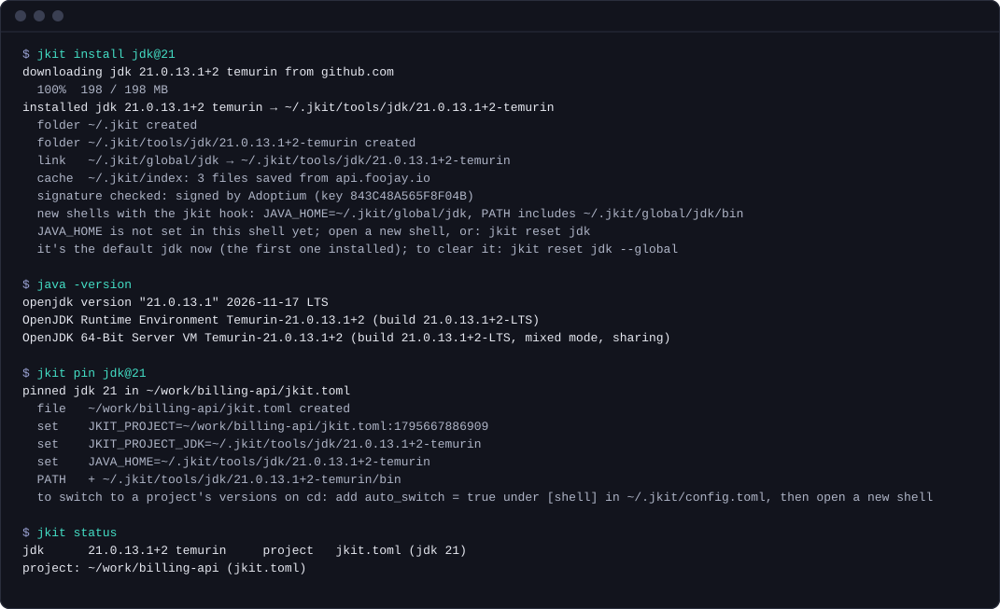

<h1>
  <picture>
    <source media="(prefers-color-scheme: dark)" srcset="branding/jkit-wordmark-dark.svg">
    
  </picture>
</h1>

[](https://github.com/adriandeleon/jkit/actions/workflows/ci.yml)
[](https://github.com/adriandeleon/jkit/releases/latest)
[](#install)
[](LICENSE)

Installs and switches JDKs (20+ vendors), Maven, Gradle and sbt: per shell, per project or
globally. One native binary, no JDK needed to run it.

jkit is developed with [Claude Code](https://claude.com/claude-code), Anthropic's AI coding
agent: much of its code, tests and docs are written with it, and commits it helped write say so
(`Co-Authored-By: Claude`). Every change goes through the same checks: unit tests on Linux, macOS
and Windows, native builds, and signed, attested releases.

Website: <https://jkit-project.dev>



## Quickstart

```bash
brew install adriandeleon/tap/jkit     # or see Install below
jkit hook --install                    # adds a short marked block to ~/.bashrc, ~/.zshrc or fish's config
# open a new shell, then:
jkit install jdk@21                    # the first JDK you install becomes the default
java -version
```

Then, as needed:

```bash
jkit search jdk                        # vendors and releases (jkit search jdk@21 zulu: every build)
jkit install jdk@lts zulu              # newest long-term-support release from a vendor
jkit use jdk@21 --global               # the default for new shells
jkit use jdk@17 zulu                   # only this shell
jkit install maven                     # also gradle@8.14, sbt
jkit pin jdk@21                        # record it in this project's jkit.toml
jkit exec jdk@17 -- mvn test           # one command, no shell change (scripts, CI, agents)
jkit status                            # what's active here, and why
jkit doctor                            # what's wrong with the setup, and how to fix it
jkit upgrade                           # newest build within each installed release (21.0.5 → 21.0.9)
jkit prune --dry-run                   # what old builds, leftovers and old cache prune would remove
jkit self-update                       # jkit itself (or how to, for brew, apt, dnf and winget)
```

## Why jkit

Next to SDKMAN, mise and asdf, jkit is narrower and stricter:

- One native binary. Running it needs no JDK, bash or plugins.
- Every download is checked against its published checksum, and the main JDKs, Maven and sbt
  also against their publisher's OpenPGP signature ([how](#how-it-works)).
- JDKs from 20+ vendors through foojay. Projects keep their `.sdkmanrc`, `.tool-versions` or
  `.java-version`: jkit reads them.
- `jkit exec` and `--json` for scripts, CI, editors and agents.
- Nothing changes out of sight: jkit prints each folder, link and variable it touches.

What it doesn't do: it manages JDKs, GraalVM, Maven, Gradle and sbt, nothing else (no Kotlin,
JBang, Scala, Node, …); SDKMAN, mise and asdf cover far more tools. Windows support is a preview.

## Install

| Platform | |
| --- | --- |
| macOS (Apple Silicon, Intel), Linux | `brew install adriandeleon/tap/jkit` |
| Debian, Ubuntu (x64, arm64) | `sudo apt install jkit` from the [Vitrina](https://vitrina-project.dev) apt repository ([setup](https://jkit-project.dev/install/#apt)), or the `.deb` from the [releases](https://github.com/adriandeleon/jkit/releases): `sudo apt install ./jkit_*_amd64.deb` (`_arm64.deb` on ARM) |
| Fedora, RHEL, Rocky, Alma 9+ | the `.rpm`: `sudo dnf install ./jkit-*.x86_64.rpm` (`.aarch64.rpm` on ARM) |
| Windows x64 (preview) | `winget install AdrianDeLeon.jkit` (once winget-pkgs has merged the release; until then, the `.zip`). See [docs/windows.md](docs/windows.md) |
| Alpine and other musl Linux (x64) | the `-linux-x64-musl` `.tar.gz` from the releases (from 0.5.0; GraalVM can't build a musl binary for arm64 yet) |
| Anything else | a `.tar.gz` or `.zip` from the releases; put `jkit` anywhere on your `PATH` |

Linux builds, Homebrew's included, need glibc 2.34+ and zlib (Debian 12+, Ubuntu 22.04+, RHEL 9+);
the `-musl` builds are static and need nothing from the system. macOS builds need macOS 14+ (15
for 0.4.0 and earlier) and are signed and notarized. Pre-releases are on the releases page only.

To verify a download (`SHA256SUMS` and its signature, build attestations, the signed `.deb` and
`.rpm`), see [SECURITY.md](SECURITY.md#verifying-a-download).

`jkit self-update` replaces a jkit from a `.tar.gz` or `.zip` after checking it against the
release's signed `SHA256SUMS`; for Homebrew, apt, dnf and winget it prints that tool's upgrade command.

## How it works

- Nothing outside `~/.jkit` (below) is touched except the marked block `jkit hook --install` adds
  to your shell's startup file. Every change is printed: folders, links, cache files, variables.
- The global default is a link, `~/.jkit/global/<tool>`, which the hook puts on `PATH` and uses for
  `JAVA_HOME`, `MAVEN_HOME`, `GRADLE_HOME`, `SBT_HOME` and `GRAALVM_HOME`; point an IDE at
  `~/.jkit/global/jdk` and it follows `jkit use … --global`. `jkit use` without `--global`
  changes only the current shell, through the hook.
- Downloads come over https only and are checked against their source's checksum (SHA-256 or
  stronger; SHA-1 only, as for old Maven, installs marked unverified; none is refused). Temurin,
  Microsoft and Corretto, Maven 3.9.0+ and sbt are also checked against their publisher's OpenPGP
  signature, with keys built into jkit: a missing or bad one stops the install. `--allow-unverified`
  overrides both, marked unverified; `jkit search` marks builds with nothing to check ○.
  [Details](SECURITY.md#what-jkit-verifies).
- No telemetry and no background update checks. Only `install`, `search`, `sync`, `upgrade`,
  `pin`, `config set`, `self-update` and `doctor --network` go online, and only to
  [foojay](https://foojay.io) and the vendor download it lists, services.gradle.org, Maven
  Central, and GitHub (sbt's and jkit's own releases). `use`, `status`, `list`, `env`, `exec`,
  `doctor` and the shell hook never do.

| Path | What |
| --- | --- |
| `~/.jkit/tools/<tool>/<version>` | installed JDKs, Maven, Gradle and sbt |
| `~/.jkit/global/` | links to the global defaults |
| `~/.jkit/index/` | version lists, cached 24 h (`--refresh` refetches, `--offline` uses only the cache) |
| `~/.jkit/config.toml` | settings (below) |
| `JKIT_HOME` | moves all of it: an absolute path to a folder you (or root) own that others can't write to |

### Settings

`~/.jkit/config.toml` holds three: `jdk.vendor` (default `temurin`), `graalvm.vendor`
(`graalvm-ce`) and `shell.auto_switch` (switch on `cd`, default `false`). `jkit config` lists them
and where each value comes from; `jkit config set jdk.vendor zulu` changes the file, keeping its
comments. The file and the environment variables (vendors, proxy, offline, mirrors):
[docs/settings.md](docs/settings.md).

## Projects

A `jkit.toml` (or an existing `.sdkmanrc`, `.tool-versions` or `.java-version`) records a project's
versions. `jkit pin jdk@21` writes it, `jkit sync` installs what it asks for and switches this shell,
and with auto-switch on, bash, zsh and fish switch on `cd`. See
[docs/project-files.md](docs/project-files.md).

## More

- [docs/troubleshooting.md](docs/troubleshooting.md): `status`, `doctor` and `env`.
- [docs/agents.md](docs/agents.md): using jkit from scripts, CI and AI agents (`jkit exec`).
- [docs/json.md](docs/json.md): `--json` output for editors and tools.
- [docs/windows.md](docs/windows.md): the PowerShell hook, `jkit env --install`, the VC++ runtime.
- Editors: [Editora](https://editora-project.dev/) 0.29.0+ drives every jkit command
  ([its jkit docs](https://editora-project.dev/docs/build-tools/#jkit)).
- `jkit <command> --help` for every option. Tab completion comes with the hook (bash; zsh through
  bashcompinit).
- Building and contributing: [CONTRIBUTING.md](CONTRIBUTING.md); design notes in
  [docs/design/](docs/design/).

## Uninstall

```bash
jkit hook --uninstall          # takes the block out of your shell's startup file
rm -rf ~/.jkit                 # every install, link and setting
brew uninstall jkit            # or: sudo apt remove jkit, sudo dnf remove jkit, winget uninstall AdrianDeLeon.jkit
```

## Not yet

Switching on `cd` in PowerShell, `jkit hook --install` for PowerShell, native fish and zsh
completion, signature checks for other JDK vendors (Gradle publishes no signatures), and
Windows on ARM natively.

## License

MIT, see [LICENSE](LICENSE). Bundled components are listed in
[THIRD-PARTY-NOTICES](THIRD-PARTY-NOTICES).
